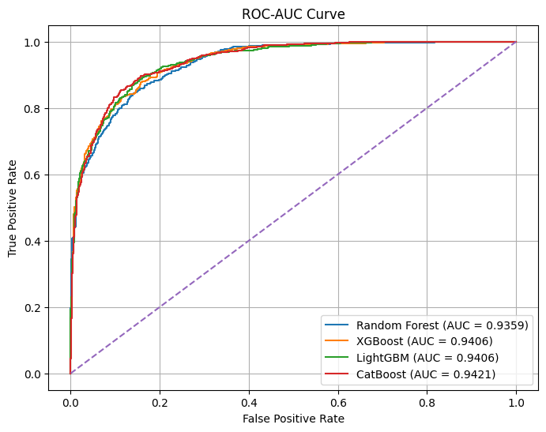
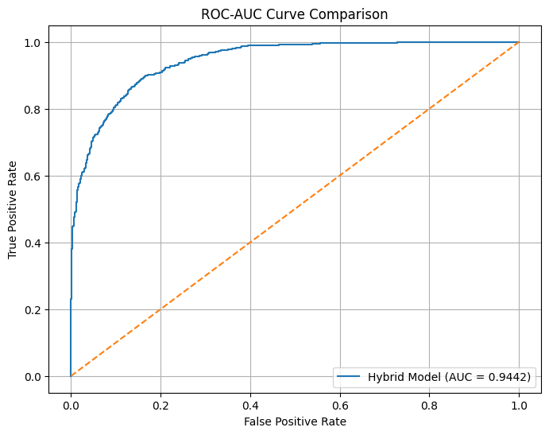
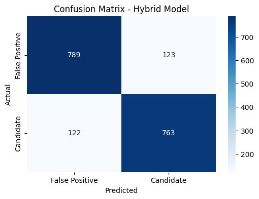
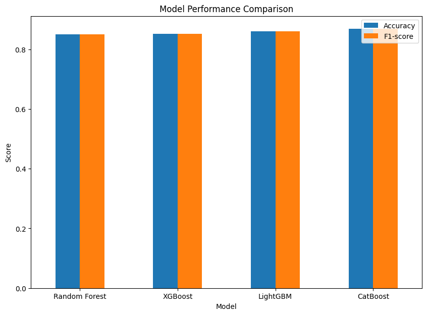

# Exoplanet Detection Using Tree-Based Models and a Hybrid Ensemble

Classifying Kepler Objects of Interest (KOIs) as **planet candidates** or **false positives** using four gradient-boosted / bagged tree models and a soft-voting hybrid ensemble built from all four.

---

## Overview

Space telescopes like Kepler produce thousands of transit signals, and many of them turn out to be false positives (eclipsing binaries, stellar noise, instrument artifacts). Checking each one by hand is slow. This project builds a machine learning pipeline that uses the stellar and transit parameters in the NASA Exoplanet Archive to separate real planet candidates from false positives.

**Pipeline**

```
NASA KOI table → cleaning & imputation → EDA → train/test split (80/20)
   → Random Forest | XGBoost | LightGBM | CatBoost  (5-fold CV + test evaluation)
   → Soft-voting hybrid ensemble of all four → metrics, confusion matrix, ROC-AUC
```

## Dataset

- **Source:** [NASA Exoplanet Archive — Kepler Objects of Interest (cumulative table)](https://exoplanetarchive.ipac.caltech.edu/cgi-bin/TblView/nph-tblView?app=ExoTbls&config=cumulative)
- **Size:** 9,564 KOIs (8,985 after cleaning), 37 numeric features
- **Target:** `koi_pdisposition` → `CANDIDATE` (4,577) vs `FALSE POSITIVE` (4,408), so the classes are roughly balanced
- **Features:** orbital period, transit depth & duration, impact parameter, planet radius, equilibrium temperature, insolation flux, model SNR, and stellar properties (effective temperature, surface gravity, metallicity, radius, mass), along with their uncertainty columns

The CSV is not included in this repo. Download it from the link above (CSV format) and place it in `notebooks/` with the filename the notebook expects, `cumulative_2026.01.16_20.39.37.csv`, or change the filename in the loading cell.

## Methodology

**Preprocessing**
- Dropped `koi_teq_err1/err2` (100% missing)
- Dropped rows with missing uncertainty values for the stellar and transit parameters
- Median imputation for `koi_smet`, `koi_impact`, `koi_prad`, `koi_depth`, then a `SimpleImputer` fit on the training set only
- Label-encoded the target and kept numeric features only

**Models**

| Model | Key settings |
|---|---|
| Random Forest | 200 trees, max depth 10, balanced class weights |
| XGBoost | 200 estimators, max depth 6 |
| LightGBM | 200 estimators, balanced class weights |
| CatBoost | 200 iterations, depth 8 |
| **Hybrid (soft voting)** | RF + XGBoost + LightGBM + CatBoost, averaged class probabilities |

Each base model was scored with 5-fold cross-validation (weighted F1) and then on a held-out 20% test set (1,797 samples).

## Results

| Model | CV F1 | Accuracy | Precision | Recall | F1 | ROC-AUC |
|---|---|---|---|---|---|---|
| Random Forest | 0.848 | 0.850 | 0.850 | 0.850 | 0.850 | 0.936 |
| XGBoost | 0.854 | 0.852 | 0.852 | 0.852 | 0.852 | 0.941 |
| LightGBM | 0.858 | 0.861 | 0.861 | 0.861 | 0.861 | 0.941 |
| CatBoost | 0.854 | **0.868** | **0.868** | **0.868** | **0.868** | 0.942 |
| **Hybrid ensemble** | — | 0.864 | 0.861 | 0.862 | 0.862 | **0.944** |

**Takeaways**
- All models reach 85–87% accuracy and ROC-AUC above 0.93, so tree ensembles handle this noisy, high-dimensional data well.
- CatBoost has the best single-model accuracy. The hybrid ensemble has the **highest ROC-AUC (0.944)** and almost perfectly balanced errors (123 vs 122 misclassifications in each direction on the test set), which makes it the more stable choice for ranking candidates.

<p align="center">
  
  
</p>
<p align="center">
  
  
</p>

## Repository Structure

```
├── notebooks/
│   └── exoplanet_detection.ipynb   # full pipeline: preprocessing, EDA, models, hybrid ensemble
├── images/                         # plots used in this README
├── requirements.txt
└── README.md
```

## Getting Started

```bash
git clone https://github.com/eesha5/exoplanet-detection-hybrid-ensemble-.git
cd exoplanet-detection-hybrid-ensemble-
pip install -r requirements.txt
# download the KOI cumulative CSV into notebooks/ (see Dataset)
jupyter notebook notebooks/exoplanet_detection.ipynb
```

## Future Work

- Add deep learning models (1D CNNs on Kepler/TESS light curves) and compare them with or stack them on top of the tabular ensemble
- Try weighted voting or stacking instead of equal-weight soft voting
- Add feature-importance and SHAP analysis to show which stellar and transit parameters drive the predictions
- Test generalization on TESS Objects of Interest (TOI)

## Acknowledgements

This research uses the NASA Exoplanet Archive, which is operated by the California Institute of Technology under contract with NASA under the Exoplanet Exploration Program.
